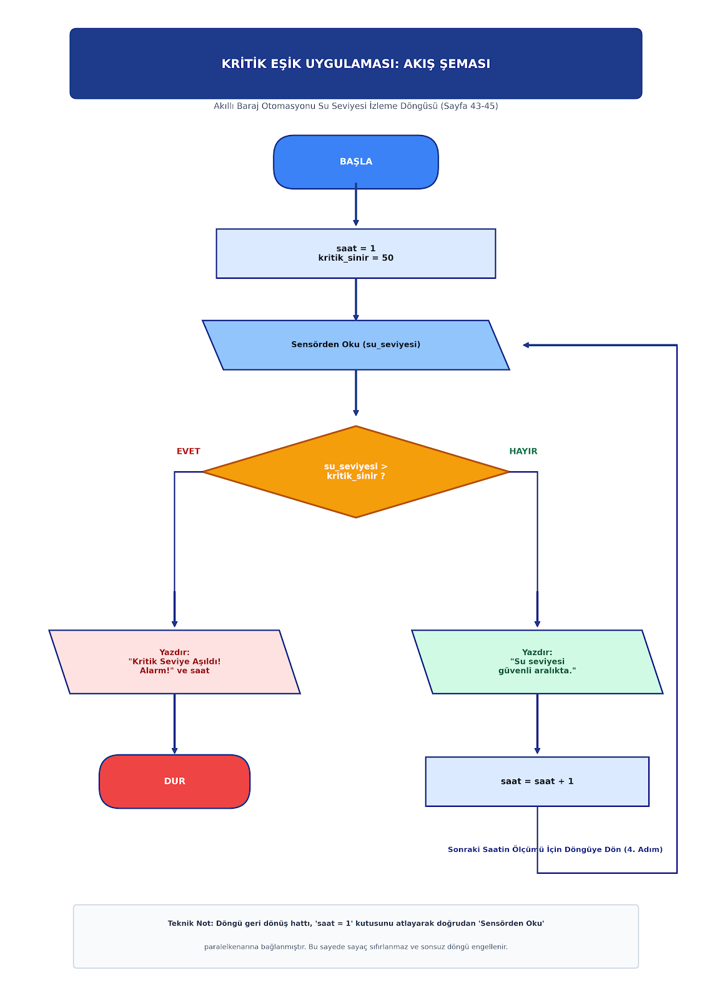
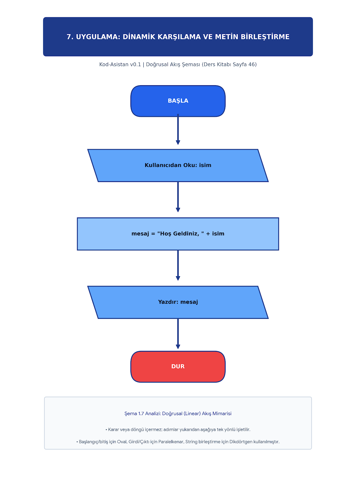

# kod_asistanim
**Proje Yazarı:** Kadir EKİZ  
**Projenin Adı:** Kod-Asistan v0.1  

## Projenin Amacı
Bu projenin temel amacı; kullanıcılara günlük rutinlerinde ve bilişim görevlerinde (karşılama, temel matematiksel hesaplamalar, veri analizi vb.) yardımcı olacak, modüler ve güvenilir bir dijital asistan tasarlamaktır. Proje, ders boyunca adım adım yeni yetenekler kazanarak sarmal bir mimariyle geliştirilecektir.

---

## Projenin Hedefleri ve Gelişim Yol Haritası (Roadmap)
Kod-Asistan projesinin sonraki sürümlerde kazanması hedeflenen özellikler:

* **v0.1 (Mevcut Durum):** Dijital depo kurulumu, proje çalışma alanı tasarımı ve akıllı baraj otomasyonu algoritması.
* **v1.0 (Akıllı Menü ve Karar Yapıları):** Kullanıcı etkileşimli dinamik seçim menüsü, harf duyarlılığı optimizasyonu ve profil/yaş hesaplama modülü.
* **v1.5 (Döngüler ve Algoritmik Çizim):** İç içe döngülerle geometrik/fraktal görselleştirme katmanı ve veri analitiği.
* **v2.0 (Veri Kalıcılığı ve Depolama):** JSON formatında profil saklama, dosya okuma/yazma (I/O) ve hata yakalama (`try-except`) blokları.
* **v3.0 (Büyük Final):** Modüler fonksiyonlar, veri maskeleme (KVKK uyumu), gelişmiş `.gitignore` güvenliği ve tam kararlı yazılım lansmanı.

---
## v0.1 Proje Kapsamı
### 🌊 Akıllı Baraj Otomasyonu: Kritik Eşik Algoritması (5. Uygulama)

Bu modül, su seviyesini sensörler aracılığıyla saatlik olarak takip eden ve kritik sınır aşıldığında sistemi güvenli biçimde durdurup alarm üreten döngüsel bir kontrol mimarisi işletir.

#### 📋 Adım Adım Sözde Kod (Pseudocode)

```text
1. Adım: BAŞLA.
2. Adım: Başlangıç saatini belirle (saat = 1).
3. Adım: Kritik sınır seviyesini tanımla (kritik_sinir = 50).
4. Adım: Sensörden gelen anlık su seviyesini oku (su_seviyesi).
5. Adım: EĞER su_seviyesi > kritik_sinir İSE:
          - Ekrana "Kritik Seviye Aşıldı: Alarm!" ve anlık saat değerini yazdır.
          - 9. Adım'a GİT.
6. Adım: DEĞİLSE:
          - Ekrana "Su seviyesi güvenli aralıkta." yazdır.
7. Adım: Zaman sayacını 1 artır (saat = saat + 1).
8. Adım: Sonraki saatlik ölçüm için 4. Adım'a GİT.
9. Adım: DUR.
```
#### 🌊 Elle Çalıştırma (Dry Run) Takip Tablosu

Algoritmanın kararlılığı ve döngüden çıkış anı aşağıdaki simülasyon verileriyle test edilmiştir:  
| Zaman (Saat) | Okunan `su_seviyesi` | Karar Kontrolü (`su_seviyesi > 50`) | Sistem Durumu / Üretilen Çıktı | Döngü Durumu |
| :---: | :---: | :---: | :--- | :---: |
| **1. Saat** | 42 m | `42 > 50` ➔ **HAYIR** | *"Su seviyesi güvenli aralıkta."* | Devam Ediyor |
| **2. Saat** | 48 m | `48 > 50` ➔ **HAYIR** | *"Su seviyesi güvenli aralıkta."* | Devam Ediyor |
| **3. Saat** | 55 m | `55 > 50` ➔ **EVET** | **"Kritik Seviye Aşıldı: Alarm!" (Saat: 3)** | **DUR (Kırıldı)** |


#### 🗺️ Algoritma Akış Şeması



### 👤 Dinamik Karşılama ve Metin Birleştirme Modülü (7. Uygulama)

Kod-Asistan v0.1 mimarisinde kullanıcıyı ismiyle karşılayan, dinamik metin birleştirme (string concatenation) mantığına dayalı temel doğrusal akış modülüdür.

#### 📋 Algoritma Adımları (Sözde Kod)

```text
1. Adım: BAŞLA.
2. Adım: Kullanıcıdan isim bilgisini al (isim).
3. Adım: mesaj = "Hoş Geldiniz, " + isim işlemini gerçekleştir.
4. Adım: Ekrana mesaj değerini yazdır.
5. Adım: DUR.
```
#### 🗺️ Algoritma Akış Şeması



---

## Kurulum ve Kullanım
Projenin ilk sürümünü yerel bilgisayarınızda test etmek için:
1. Depoyu bilgisayarınıza klonlayınız veya ZIP olarak indiriniz.
2. Dosyaları Visual Studio Code ortamında açınız.
3. İlerleyen adımlarda eklenecek Python dosyalarını doğrudan çalıştırabilirsiniz.

---

## Kaynakça ve Etik Beyan

> *"Hakkı teslim etmek, emeğe saygı duymak ve ustadan devralınan bilgi mirasını dürüstçe yaşatmak kadim Ahilik ahlakının en temel kuralıdır."*

Bu projenin algoritmik kurgusu, karar yapıları ve teknik standartları geliştirilirken Millî Eğitim Bakanlığı ders materyalleri ile alanın temel referans kaynaklarından faydalanılmış olup akademik/mesleki dürüstlük ilkesi gereğince atıflar aşağıda sunulmuştur:

1. **Millî Eğitim Bakanlığı.** (2026). *Programlama Temelleri (9. Sınıf Ders Kitabı)*. Meslekî ve Teknik Eğitim Genel Müdürlüğü, Ankara.
2. **MEB MTEGM.** (2026). *Bilişim Teknolojileri Alanı Çerçeve Öğretim Programı*. Ankara.
3. **Downey, A. B.** (2015). *Think Python: How to Think Like a Computer Scientist* (2nd ed.). O’Reilly Media.
4. **Matthes, E.** (2023). *Python Crash Course: A Hands-On, Project-Based Introduction to Programming* (3rd ed.). No Starch Press.

---
### 🤝 Eş-Geliştirici (Pair-Programmer) ve İnsan Denetimi Beyanı
Proje sürecinde algoritmaların test edilmesi, dokümantasyon kurgusu ve olası mantık hatalarının tespiti aşamalarında yapay zekâ teknolojilerinden bir **eş-geliştirici** olarak istifade edilmiştir. Üretilen tüm sözde kodlar ve mantıksal akışlar, bilişim etiği ve insan denetimi süzgecinden geçirilerek projeye entegre edilmiştir.

## Mesleki Etik ve Geliştirici İlkeleri
* **Sürüm Kontrolü ve Şeffaflık:** Yapılan her değişiklik düzenli ve açıklayıcı commit notlarıyla depoya kaydedilir.
* **Veri Güvenliği:** Projede gerçek kişisel veriler kullanılmaz, testler maskelenmiş verilerle yürütülür.
* **Eş-Geliştirici İlkesi:** Yapay zekâ araçları birer eş-geliştirici olarak kullanılır; üretilen tüm kodlar insan mantığı süzgecinden geçirilir.

---
